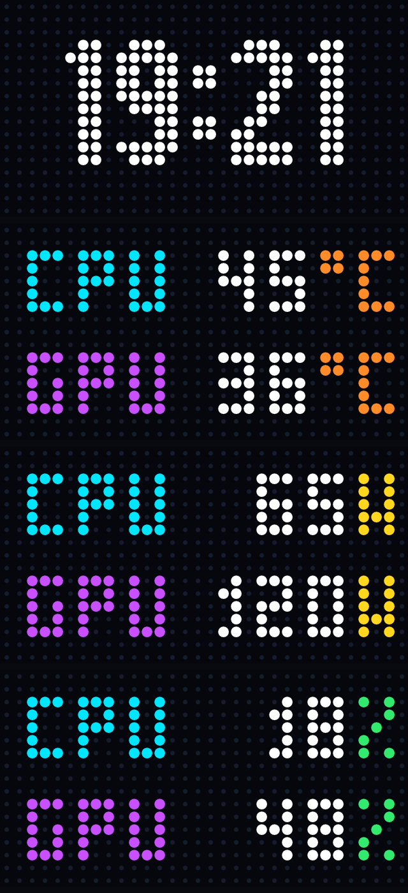

# HM Lab Z-Neo Hardware Monitor 🖥️⚡

[](https://dotnet.microsoft.com/)
[](https://microsoft.com)
[](https://github.com/furkan-cakici/HM-Lab-ZNeo-Monitor)
[-success)](https://github.com/furkan-cakici/HM-Lab-ZNeo-Monitor)
[](LICENSE)
[](https://github.com/furkan-cakici)

A lightweight, high-performance, and completely autonomous Windows service and system tray monitor for the **HM Lab Z-Neo 8K Gaming USB Hub**'s 32x17 RGB LED matrix screen.

Replaces bloated, slow, and resource-heavy manufacturer software (Electron/Web) with a native, zero-driver C# service running at **30 FPS** with **<0.5% CPU** and **~75 MB RAM**.

---

## 📸 Preview



| Page 0: Digital Clock | Page 1: Temperature (°C) | Page 2: Power Draw (Watts) | Page 3: Load & Usage (%) |
| :---: | :---: | :---: | :---: |
|  |  |  |  |

> 💡 *An interactive browser preview is available in [`assets/display_preview.html`](assets/display_preview.html).*

---

## ✨ Features

* **4-Page Multi-Screen Carousel:**
  * **Page 0 (Main Clock):** Large, 2-pixel thick crisp digital clock with 1 Hz blinking colon (`:`) centered on a deep black background.
  * **Page 1 (Temperature):** CPU and GPU temperatures in pure bright white with warm amber (`°C`) accents.
  * **Page 2 (Power Draw):** CPU and GPU real-time power consumption in white with solar gold (`W`) accents.
  * **Page 3 (Utilization):** CPU and GPU load in white with emerald mint (`%`) accents.
  * Automatically transitions every **5 seconds** (configurable to 3s, 5s, or 8s).
* **Vibrant Typography & Pixel Alignment:**
  * Handcrafted 3x5 and 5x10 bitmap fonts.
  * Cyan (`#00E6FF`) for **CPU**, Neon Purple (`#C850FF`) for **GPU**, and pure white (`#FFFFFF`) for numbers.
  * Right-aligned values for stable, non-shifting digits.
* **100% Zero-Driver & Windows 11 HVCI / Core Isolation Safe:**
  * No dangerous kernel drivers (`WinRing0x64.sys`) that trigger Windows Defender or Core Isolation memory integrity blocks.
  * Direct GPU metrics via official NVIDIA NVML / `nvidia-smi`.
  * Direct CPU load & frequency via Windows Kernel API (`GetSystemTimes`, `powrprof`).
  * Seamless fallback and support for **HWiNFO Shared Memory** (`HWiNFO_SENS_SM2`) when active.
  * Thermal and power inertia model prevents rapid jumping/flickering.
* **Extreme Efficiency & Zero-GC Hot Loop:**
  * Delivers a constant **30 FPS** stream over USB HID.
  * Reusable memory buffers eliminate continuous garbage collection pauses.
  * Consumes only **~75 MB RAM** (vs 350+ MB for vendor apps) and negligible CPU.
* **System Tray Controls:**
  * Switch between Auto Carousel, Clock Only, Temp Only, Watt Only, Load Only, or the classic Sci-Fi Cockpit Orb design.
  * Change LED Matrix Style: Anti-aliased / Faded (Smooth), Retro Square, or Circle Matrix.
  * One-click "Start with Windows" (Task Scheduler integration).

---

## 🛠️ Hardware & Protocol Specifications

* **Supported Device:** HM Lab Z-Neo 8K Gaming USB Hub (sold via Wraith Esports, Arbiter Studio, etc.).
* **Screen:** 32 columns x 17 rows RGB LED matrix display.
* **USB HID Interface:**
  * **Vendor ID:** `0xC019`
  * **Product ID:** `0x0401`
  * **Target Collection:** `COL05`
  * **Packet Structure:** 1,632-byte 24-bit RGB frame split into 7 HID reports (252-byte payloads, Report ID `0x05`).
* **Serial Port Interface:**
  * **Port:** `COM3` (115200 baud, 8-N-1).
  * Used to query and enforce **sRGB color space** and LED style configuration with 32-bit CRC validation.

---

## 🚀 Quick Start (Pre-built Release)

1. Download the latest pre-compiled archive from [Releases](https://github.com/furkan-cakici/HM-Lab-ZNeo-Monitor/releases).
2. Extract the folder to any location on your PC.
3. Double-click `Start.bat` to launch the background service.
4. *(Optional)* Right-click `AutoStart_Install.bat` and select **"Run as Administrator"** to enable automatic launch upon Windows logon.

### Script Overview

| Script | Description |
| :--- | :--- |
| `Start.bat` | Launches the hardware monitor service. |
| `Start_Silent.vbs` | Launches the service silently without opening any console window. |
| `Stop.bat` | Cleanly terminates the active monitor service. |
| `AutoStart_Install.bat` | Registers a Windows scheduled task to automatically launch on logon with elevated privileges. |
| `AutoStart_Uninstall.bat` | Removes the auto-start scheduled task. |

---

## 🔨 Building from Source

### Prerequisites
* [.NET 10.0 SDK](https://dotnet.microsoft.com/download) (or Windows 10/11 with .NET Desktop Runtime)
* Windows 10 or 11 (64-bit)

### Build Steps

```powershell
# 1. Clone repository
git clone https://github.com/furkan-cakici/HM-Lab-ZNeo-Monitor.git
cd HM-Lab-ZNeo-Monitor

# 2. Build Release binary
dotnet build HMHubScreenMonitor.sln -c Release

# 3. (Optional) Run automated deployment script
powershell -ExecutionPolicy Bypass -File deploy.ps1
```

---

## 📂 Project Structure

```text
├── HMHubScreenMonitor/
│   ├── HMHubScreenMonitor.csproj   # .NET 10 Windows Forms / Service project definition
│   └── Program.cs                  # Complete HID streaming, sensor, and font rendering engine
├── HMHubScreenMonitor.sln          # Classic Visual Studio solution
├── HMHubScreenMonitor.slnx         # Modern .NET 10 solution
├── assets/                         # High-res screen previews and HTML demo
├── scripts/                        # Ready-to-use launch and automation scripts
├── deploy.ps1                      # Automated build & local deployment helper
├── .gitignore                      # Standard .NET repository ignore rules
├── LICENSE                         # MIT License
└── README.md                       # Documentation
```

---

## 📄 License

This project is open-source under the [MIT License](LICENSE).
Feel free to use, modify, and distribute it.
